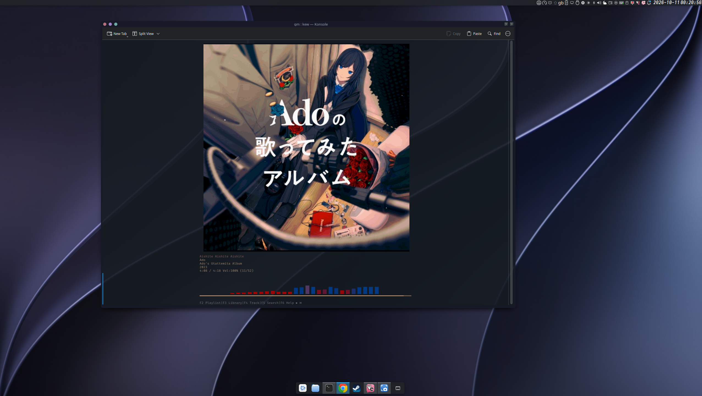

Eh hello! Welcome to my personal dotfiles for **Bazzite (Fedora Silverblue/Atomic)** running **KDE Plasma 6 (Wayland)**. 

---

fyi kando built in
---

## Chop-Chop 1-Command Settle

```bash
git clone https://github.com/danboy12342/dotfiles_fedora_bazz.git ~/dotfiles
cd ~/dotfiles
./install.sh
```

> **Aiyo, take note hor:** After the script finish running, must **log out and log in again**! If not, KDE panel and KWin effects won't take effect properly.

---

## where go put things?

```text
dotfiles/
├── install.sh                  # Run this to restore everything automatically
├── Brewfile                    # All brew tools (fastfetch, starship, kew, cava...)
├── flatpaks.txt                # Flatpak apps (Kando, Vesktop...)
├── config/
│   ├── fastfetch/              # Fastfetch config + UTEPseal.png inside
│   ├── kew/                    # Kew player setting
│   ├── cava/                   # Jumping audio bar visualizer config
│   └── environment.d/          # Wayland plugin path configs
├── kando/
│   └── menus.json              # Custom pie menu layout
├── kde/
│   ├── plasma-org.kde...       # Panel and dock settings
│   ├── kwinrc                  # Window buttons on the left
│   └── kglobalshortcutsrc      # Spotlight / KRunner hotkeys
├── local/
│   └── kwin_plugins/           # Compiled kandointegration.so file
└── shell/
    └── .bashrc                 # Bashrc with Homebrew & Starship inside
```

---

shortcuts?

| :--- | :--- |
| `Ctrl + Space` | Summon **Kando** radial menu at cursor |
| `Meta + Space` | Open **Spotlight** (Centered KRunner search) |
| `Ctrl + Shift + T` | Open new tab in Konsole |
| `Super` (Windows key) | Open application launcher |

---

